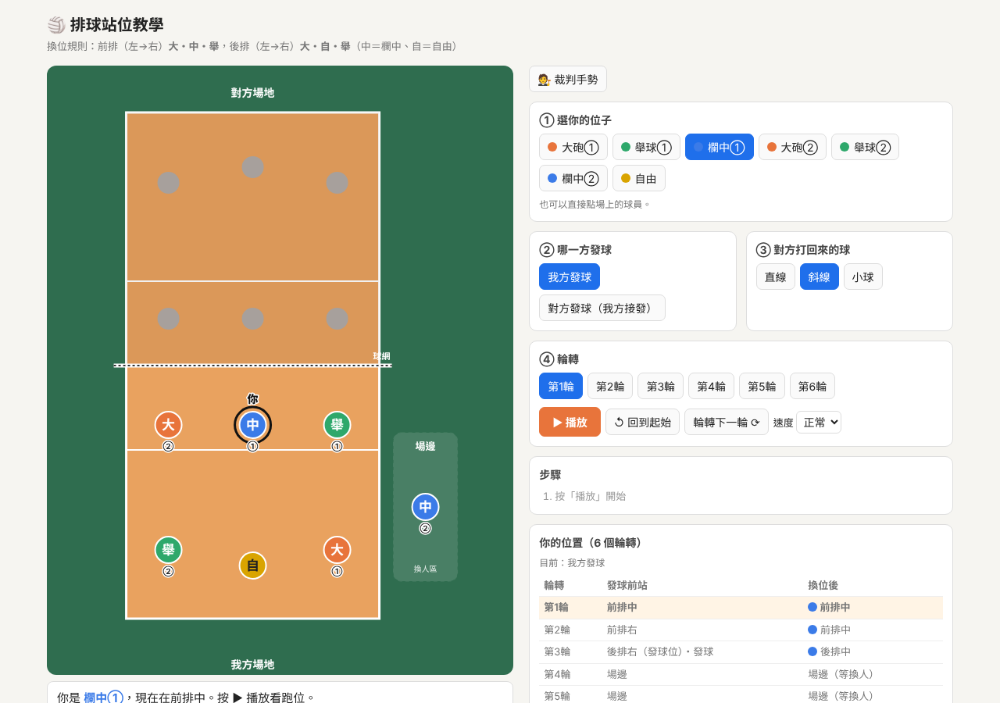
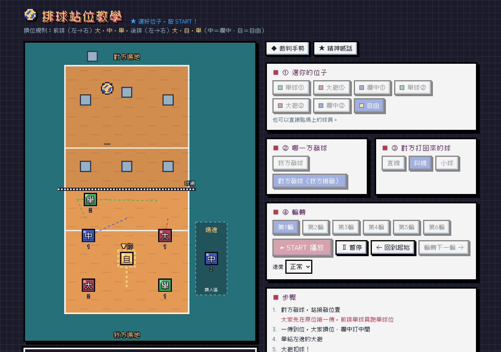
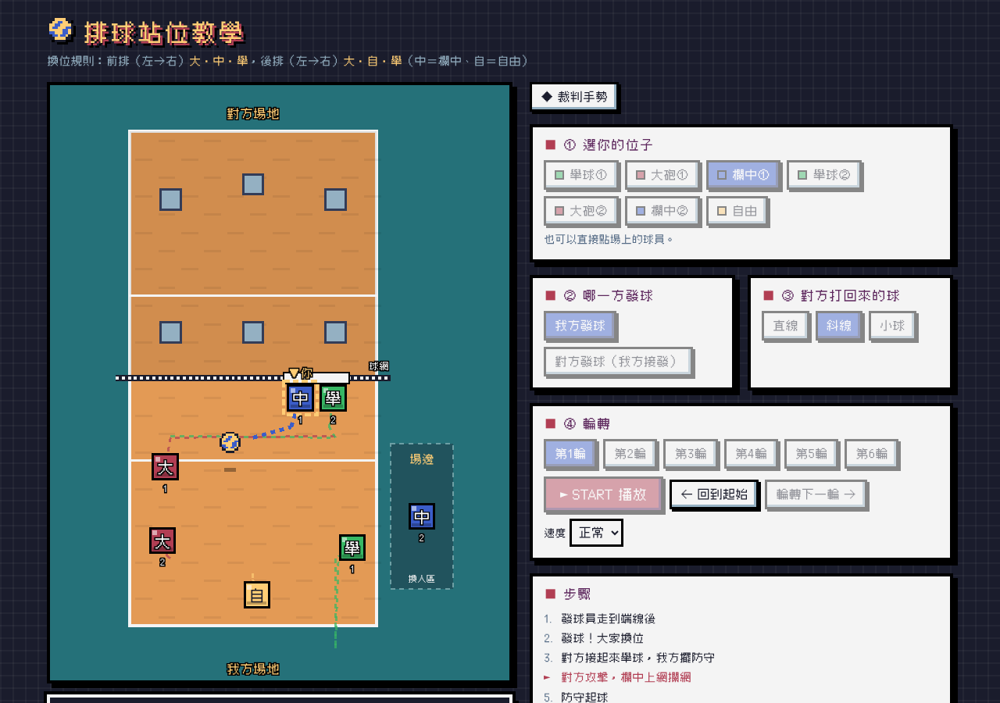
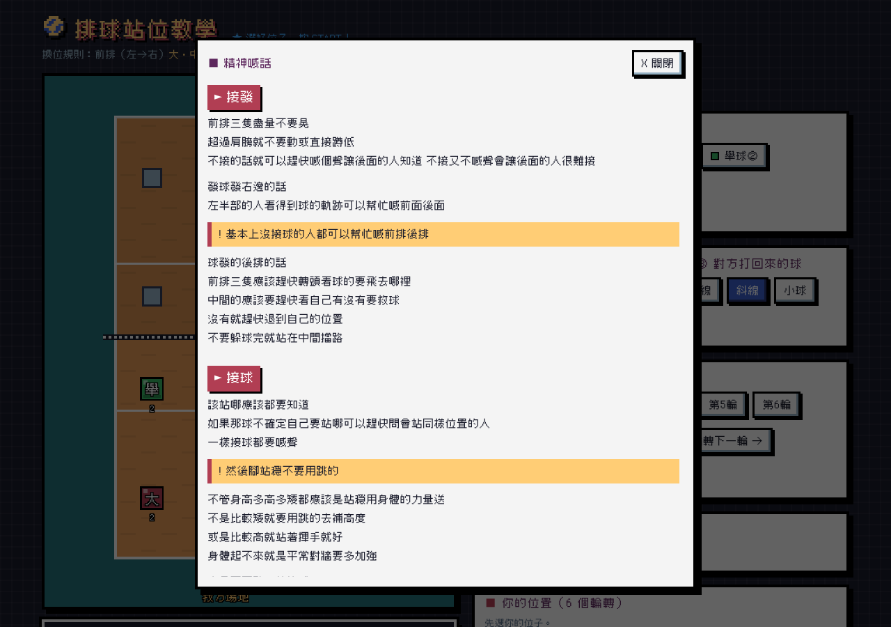
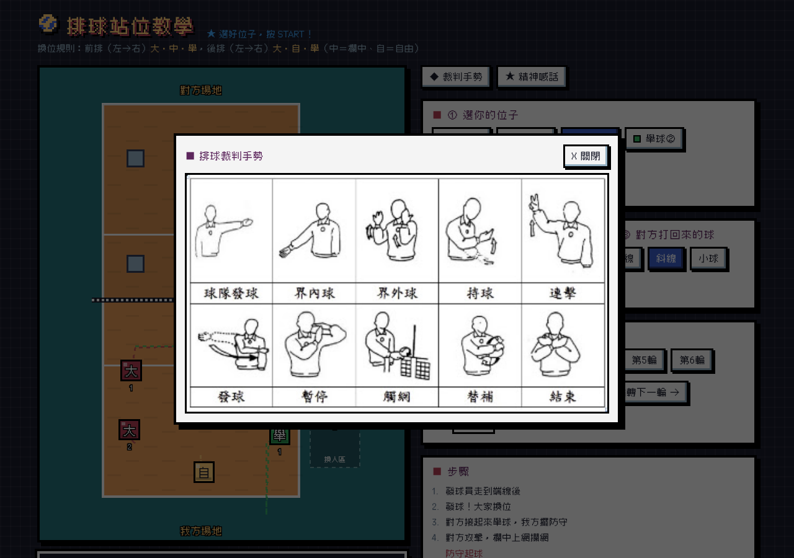
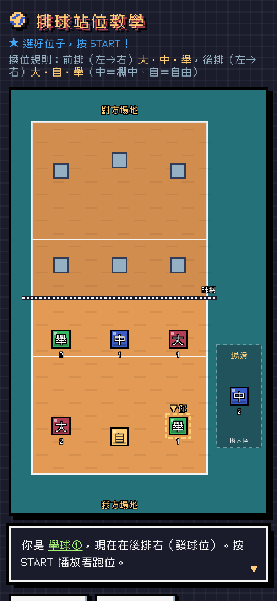

# 🏐 排球輪轉站位模擬器

用**像素風遊戲畫面**的動畫，教隊友排球的**輪轉、換位、接發、攔網與防守站位**。選好自己的位置，按下 START，就能看到像素排球怎麼飛、每個人要往哪裡跑。

👉 **線上使用：<https://hyjessica0907.github.io/volleyball/>**（電腦、手機都能開）

---

## 站位規則

| | 左 | 中 | 右 |
|---|---|---|---|
| **前排** | 大（大砲） | 中（欄中） | 舉（舉球） |
| **後排** | 大（大砲） | 自（自由） | 舉（舉球） |

- 輪轉順序：舉球① → 大砲① → 欄中① → 舉球② → 大砲② → 欄中②（對角同職位）
- 第 1 輪由**舉球①**發球，前排左→右是 舉球・欄中・大砲，發球後再換成 大・中・舉
- 欄中轉到後排時換**自由**上場，欄中到場邊等；輪到欄中發球的那一輪由欄中自己發，等我方失分、換對方發球時，自由再換回來

## 畫面風格

整個網頁做成復古像素遊戲的樣子：
- 像素字體（俐方體 11 號 Cubic 11）
- 球員是方塊像素角色，選到的人頭上會出現「▼你」標記
- 像素排球（黃藍配色）、木紋地板、格子球網
- 字幕做成 RPG 對話框，右下角有閃爍的 ▼
- 按鈕有立體像素陰影，按下去會往下沉，START 按鈕會閃爍
- 步驟清單用 ► 游標標出目前進行到哪一步

## 功能介紹

### ① 選你的位子
可以選大砲①②、舉球①②、欄中①②、自由，或直接點場上的球員。選到的人會有黑圈和「你」標記，跑動路線是粗虛線。

### ② 選哪一方發球
- **我方發球**：發球員走到端線後發球，球一離手，大家換到自己的位置。
- **對方發球（我方接發）**：一選「對方發球」，球員就會先排好接發站位。前排舉球員站網前，其他五個人站 **W 型**接發（照輪轉順序，不能提早換位）→ 球過網時大家**先在原位接一傳**，只有前排舉球員快跑到舉球位 → 一傳到位後大家才換位，欄中往網前衝準備打中間 → 舉給左邊大砲扣球。
  - **前排是 舉・中・大 的輪次**（舉在最左、大砲在最右，第 1、4 輪）：前排不硬換位，第一球可以選「大砲先打中間」或「欄中先打最左邊」，打完這一球前排才換到正確位置。

### ③ 對方打回來的球
可以選對方打 **直線**、**斜線** 或 **小球**：
- 欄中跑到右邊，跟舉一起上網攔網
- 後排：大砲守斜線、自由守深球、舉守直線和小球
- 攔完網後，欄中退到三米線準備攻擊，不擋舉球員的路

### ④ 輪轉
- 可以直接切換第 1～6 輪
- 按「輪轉下一輪」會用動畫顯示大家順時針移一格，並標出**誰下場、誰上場**（自由和欄中在場邊換人區交換）
- 「你的位置」表格會列出你在 6 個輪轉發球前站哪、換位後跑去哪

### 其他
- **動畫說明**：場地下方的字幕和右邊的「步驟」清單，會跟著動畫一步一步說明
- **暫停 / 繼續**：播放中可以隨時按「Ⅱ 暫停」停在某個畫面講解，再按「► 繼續」接著播
- **速度**：可調慢、正常、快（播放中也能直接切換）
- **◆ 裁判手勢**：按下去會跳出排球裁判手勢圖
- **★ 精神喊話**：整理接發、接球、攔網、吊球、喊聲的觀念與提醒，重點用黃底標出來

- **♪ 8-bit 音效**：哨音、發球、接球、舉球、扣球、攔網、輪轉、按鈕都有像素遊戲風的音效（用瀏覽器即時合成，不需要音檔）；右上角「♪ 音效」可以開關，會記住你的選擇
- **場邊人物**：左下角有 Q 版女生攝影師（相機會閃光），右側場邊上方有教練席，教練會輪流喊話（例如「專注下一球！」「攔網手要硬！」），底線後方有會跳動的啦啦隊（中間是戴安全帽、彩虹爆炸頭的啦啦隊會長）

### 手機版
畫面會自動改成單欄，球場在上、操作按鈕在下。

---

## 檔案

| 檔案 | 說明 |
|---|---|
| `index.html` | 整個網頁（HTML + CSS + JavaScript，不需安裝任何套件） |
| `referee.jpg` | 裁判手勢圖 |
| `favicon.ico`、`favicon-*.png`、`apple-touch-icon.png` | 分頁與書籤圖示（像素排球） |
| `fonts/` | 像素字體 Cubic 11 與授權檔（OFL） |
| `screenshots/` | README 用的畫面截圖 |

想在自己電腦上看，直接用瀏覽器打開 `index.html` 就可以了。

## 字體授權

像素字體使用 [俐方體 11 號（Cubic 11）](https://github.com/ACh-K/Cubic-11)，依 SIL Open Font License 1.1 授權，授權全文在 `fonts/OFL.txt`。
